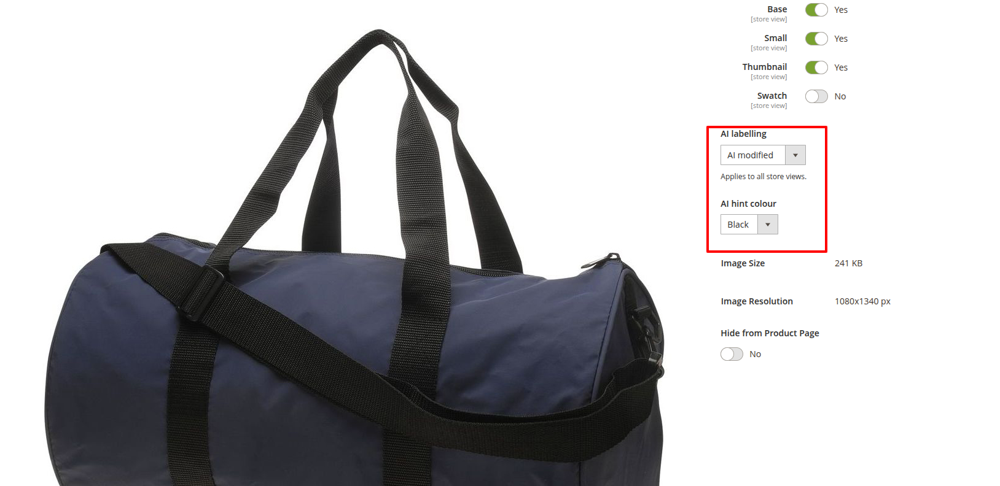
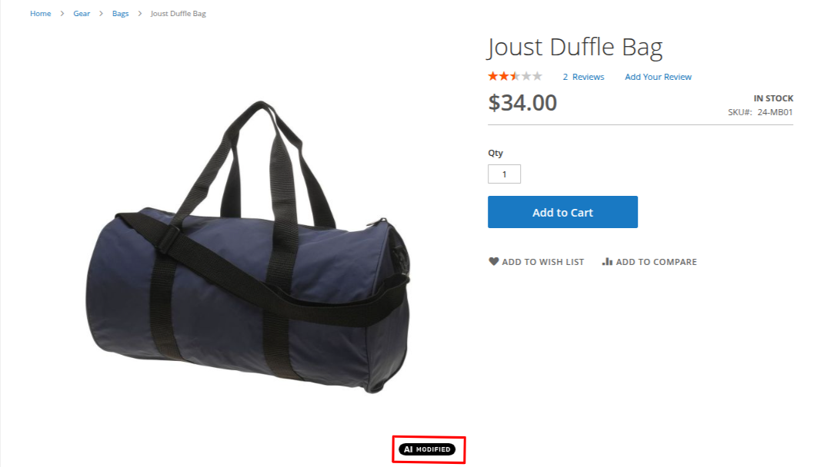
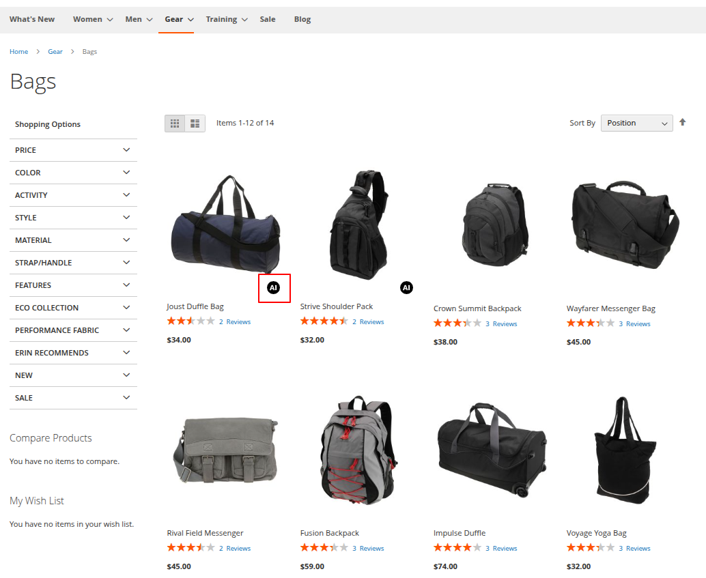
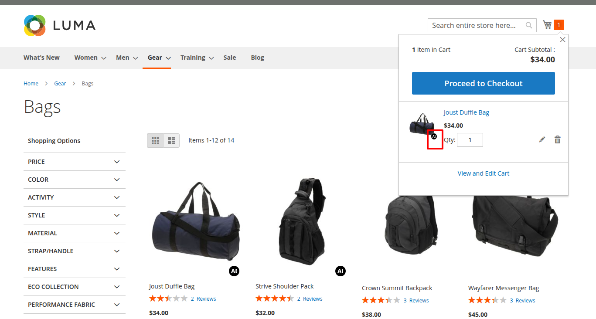
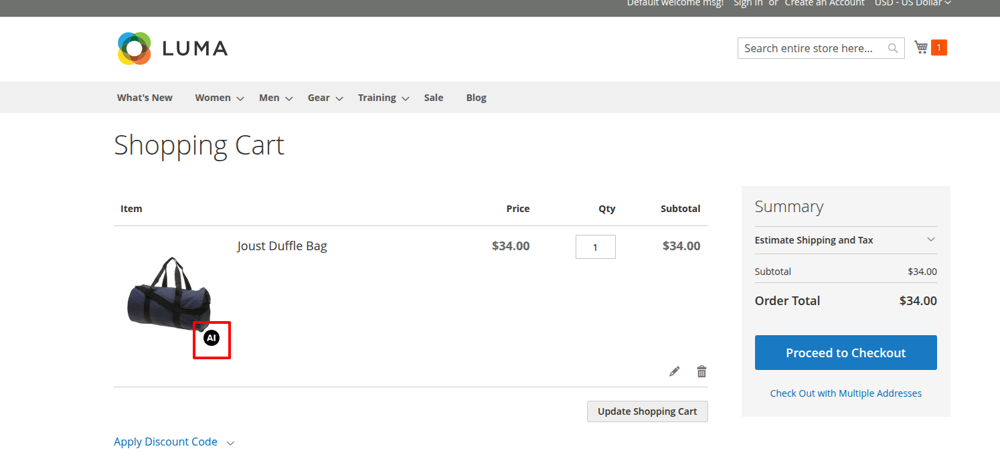
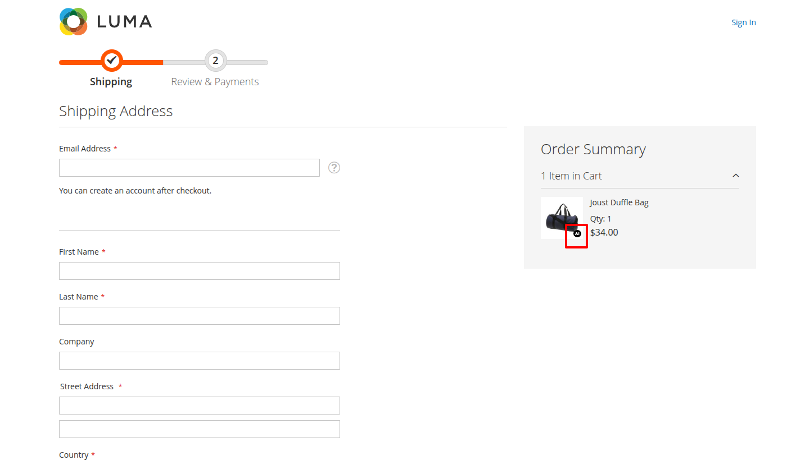

# CustomGento_AiImageHint

Label AI generated and AI modified product images in Magento 2 with the official EU AI icon.

## Why you need it

- **EU AI Act:** transparency rules for AI content apply from 2 August 2026 (Regulation (EU) 2024/1689).
- **Consumer protection:** AI images that look like real photos can mislead customers.
- **Trust:** a clear label shows you are open about your images.

Magento has no way to flag AI images. This module adds it. It is a tool, not legal advice.

## Requirements

- Magento 2.4 with Luma or a Luma based theme
- PHP 8.2 - 8.5

## Installation

```bash
composer require customgento/module-ai-image-hint-m2
bin/magento module:enable CustomGento_AiImageHint
bin/magento setup:upgrade
```

## Usage

1. Go to *Catalog > Products*, edit a product, open *Images And Videos*.
2. Click an image to open *Image Detail*.
3. Set **AI labelling**: *No AI used*, *AI modified* or *AI generated*.
4. Pick the **AI hint colour**: black or white.
5. Save the product.

The label applies to all store views.



## Features

- Label each product image in the admin
- Black or white icon per image
- Official EU icons: full label on the main image, small AI mark elsewhere
- Alt text and tooltip for accessibility
- Translatable, German included
- Labels are per product, even when products share an image file
- Labels are kept when a product is duplicated
- Imports and API saves leave labels untouched
- No configuration needed

## Where the label shows

- Product page gallery: full label on the main image (also fullscreen), small mark on thumbnails
- Category pages and search results
- Product widgets, related products, up-sells, cross-sells
- Cart, minicart and checkout summary
- Wishlist and compare pages

The icon sits bottom right, away from Sale / New labels.

**Product page**



**Category page**



**Minicart**



**Cart**



**Checkout**



## Not covered yet

- Images of configurable product options
- Recently viewed, wishlist and compare sidebars, search autocomplete
- Third party gallery extensions that replace Magento's gallery
- Minicart updates a changed label only after the next cart update

## Customising the look

| Class | Used for |
| --- | --- |
| `.ai-image-hint` | every icon |
| `.ai-image-hint--full` | full label on the main product image |
| `.ai-image-hint--thumb` | AI mark on product page thumbnails |
